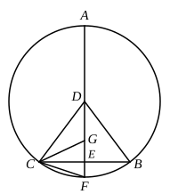

Let *ABC* be a circle, and *BC* the side of the inscribed regular pentagon.
Take *D* the centre of the circle, draw *DE* from *D* perpendicular to *BC*, and produce *DE* both ways to meet the circle in *F*, *A*.

I say that *DE* is half the sum of the side of the hexagon and of the side of the decagon inscribed in the same circle.

Let *DC*, *CF* be joined; make *GE* equal to *EF*, and join *GC*.

Since the circumference of the circle is five times the arc *BFC*,
and half the circumference of the circle is the arc *ACF*,
while the arc *FC* is half the arc *BFC*,
therefore
$$\text{(arc } ACF\text{)} = 5 \text{ (arc } FC\text{)}$$
or
$$\text{(arc } AC\text{)} = 4 \text{ (arc } CF\text{)}.$$

Hence
$$\angle ADC = 4 \angle CDF,$$
and therefore
$$\angle AFC = 2 \angle CDF.$$

Thus $\angle CGF = \angle AFC = 2 \angle CDF$;
therefore [I. 32] $\angle CDG = \angle DCG$,
so that
$$DG = GC = CF.$$

And $GE = EF$;
therefore
$$DE = EF + FC.$$

Add $DE$ to each;
therefore
$$2DE = DF + FC.$$

And $DF$ is the side of the regular hexagon, and $FC$ the side of the regular decagon, inscribed in the same circle.

Therefore etc.

---

"Next it is manifest from the theorem [12] in Book XIII. that *the perpendicular drawn from the centre of the circle to the side of the equilateral triangle [inscribed in it] is half of the radius of the circle.*

[Prop. 2.] "*The same circle circumscribes both the pentagon of the dodecahedron and the triangle of the icosahedron inscribed in the same sphere.*

"This is proved by Aristaeus in his work entitled *Comparison of the five figures*. But Apollonius proves in the second edition of his comparison of the dodecahedron with the icosahedron that, as the surface of the dodecahedron is to the surface of the icosahedron, so also is the dodecahedron itself to the icosahedron, because the perpendicular from the centre of the sphere to the pentagon of the dodecahedron and to the triangle of the icosahedron is the same.

"But it is right that I too should prove that

[Prop. 2] *The same circle circumscribes both the pentagon of the dodecahedron and the triangle of the icosahedron inscribed in the same sphere.*

"For this I need the following

Lemma.

"*If an equilateral and equiangular pentagon be inscribed in a circle, the sum of the squares on the straight line subtending two sides and on the side of the pentagon is five times the square on the radius.*"
