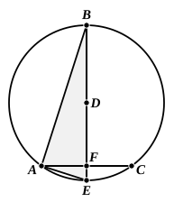
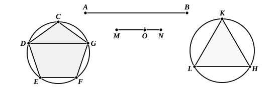

Let *ABC* be a circle, *AC* the side of the pentagon, *D* the centre; draw *DF* perpendicular to *AC* and produce it to *B*, *E*; join *AB*, *AE*.

I say that
$$BA^2 + AC^2 = 5 DE^2.$$

For, since $BE = 2 ED$,
$$BE^2 = 4 ED^2.$$

And
$$BE^2 = BA^2 + AE^2;$$
therefore
$$BA^2 + AE^2 + ED^2 = 5 ED^2.$$

But
$$AC^2 = DE^2 + EA^2; \quad \text{[Eucl. XIII. 10]}$$
therefore
$$BA^2 + AC^2 = 5 DE^2.$$

---

"This being proved, it is required to prove that the same circle circumscribes both the pentagon of the dodecahedron and the triangle of the icosahedron inscribed in the same sphere."

Let *AB* be the diameter of the sphere, and let a dodecahedron and an icosahedron be inscribed.

Let *CDEFG* be one pentagon of the dodecahedron, and *KLH* one triangle of the icosahedron.

I say that the radii of the circles circumscribing them are equal.

Join *DG*; then *DG* is the side of a cube inscribed in the sphere. [Eucl. XIII. 17]

Take a straight line *MN* such that $AB^2 = 5 MN^2$.

Now the square on the diameter of the sphere is five times the square on the radius of the circle from which the icosahedron is described. [XIII. 16, Por.]

Therefore *MN* is equal to the radius of the circle passing through the five vertices of the icosahedron which form a pentagon.

Cut *MN* in extreme and mean ratio at *O*, *MO* being the greater segment.

Therefore *MO* is the side of the decagon in the circle with radius *MN*. [XIII. 9 and 5, *converse*]

Now
$$5 MN^2 = AB^2 = 3 DG^2. \quad \text{[XIII. 15]}$$

But
$$3 DG^2 : 3 CG^2 = 5 MN^2 : 5 MO^2$$
(since, if *DG* is cut in extreme and mean ratio, the greater segment is equal to *CG*, and, if two straight lines are cut in extreme and mean ratio, their segments are in the same ratio: see lemma later, pp. 518–9).
