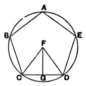
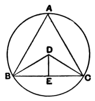

And
$$5 MO^2 + 5 MN^2 = 5 KL^2.$$
[This follows from XIII. 10, since *KL* is, by the construction of XIII. 16, the side of the regular pentagon in the circle with radius equal to *MN*, that is, the circle in which *MN* is the side of the inscribed hexagon and *MO* the side of the inscribed decagon.]

Therefore
$$5 KL^2 = 3 CG^2 + 3 DG^2.$$

But
$$5 KL^2 = 15 \text{ (radius of circle about } KLH\text{)}^2, \quad \text{[XIII. 12]}$$
and
$$3 DG^2 + 3 CG^2 = 15 \text{ (radius of circle about } CDEFG\text{)}^2. \quad \text{[Lemma above]}$$

Therefore the radii of the two circles are equal.

Q. E. D.

---

[Prop. 3.] "*If there be an equilateral and equiangular pentagon and a circle circumscribed about it, and if a perpendicular be drawn from the centre to one side, then
30 times the rectangle contained by the side and the perpendicular is equal to the surface of the dodecahedron.*"

Let *ABCDE* be the pentagon, *F* the centre of the circle, *FG* the perpendicular on a side *CD*.

I say that
$$30 CD \cdot FG = 12 \text{ (area of pentagon)}.$$

Let *CF*, *FD* be joined.

Then, since
$$CD \cdot FG = 2 (\triangle CDF),$$
$$5 CD \cdot FG = 10 (\triangle CDF),$$
whence
$$30 CD \cdot FG = 12 \text{ (area of pentagon)}.$$

Similarly we can prove that,

[Prop. 4] *If ABC be an equilateral triangle in a circle, D the centre, and DE perpendicular to BC,
$$30 BC \cdot DE = \text{(surface of icosahedron).}$$*

For
$$DE \cdot BC = 2 (\triangle DBC);$$
therefore
$$3 DE \cdot BC = 6 (\triangle DBC) = 2 (\triangle ABC),$$
whence
$$30 DE \cdot BC = 20 (\triangle ABC).$$

It follows that [Prop. 5]
$$\text{(surface of dodecahedron)} : \text{(surface of icosahedron)} = \text{(side of pentagon)} \cdot \text{(its perpendicular)} : \text{(side of triangle)} \cdot \text{(its perp.)}.$$

---

"This being clear, we have next to prove that,

[Prop. 6] *As the surface of the dodecahedron is to the surface of the icosahedron, so is the side of the cube to the side of the icosahedron.*"
