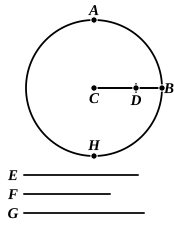

Therefore
$$5 AF \cdot GH = 10 (\triangle ABD) = 2 \text{ (area of pentagon)}.$$

And $GH = 2 HC$;
therefore
$$5 AF \cdot HC = \text{(area of pentagon)},$$
or
$$AF \cdot BH = \text{(area of pentagon)}.$$

*Proof of theorem.*

This being clear, let the circle be set out which circumscribes the pentagon of the dodecahedron and the triangle of the icosahedron inscribed in the same sphere.

Let *ABC* be the circle, and *AB*, *AC* two sides of the pentagon; join *BC*.

Take *E* the centre of the circle, join *AE* and produce it to *F*.

Let $AE = 2 EG$, $KC = 3 CH$.

Through *G* draw *DM* at right angles to *AF* meeting the circle at *D*, *M*;
*DM* is then the side of the inscribed equilateral triangle.

Join *AD*, *AM*, which are equal to *DM*.

Now, since
$$AG \cdot BH = \text{(area of pentagon)},$$
and
$$AG \cdot GD = \text{(area of triangle)},$$
therefore
$$BH : GD = \text{(area of pentagon)} : \text{(area of triangle)},$$
and
$$12 BH : 20 GD = \text{(surface of dod.)} : \text{(surface of icos.)}.$$

But $12 BH = 10 BC$, since $BH = 5 HC$, and $BC = 6 HC$;
and $20 GD = 10 DM$;
therefore
$$\text{(surface of dodecahedron)} : \text{(surface of icosahedron)} = \text{(side of cube)} : \text{(side of icosahedron)}.$$

---

"Next we have to prove that,

[Prop. 7] *If any straight line whatever be cut in extreme and mean ratio, then, as is (1) the straight line the square on which is equal to the sum of the squares on the whole line and on the greater segment to (2) the straight line the square on which is equal to the sum of the squares on the whole line and on the lesser segment, so is (3) the side of the cube to (4) the side of the icosahedron.*"

Let *AHB* be the circle circumscribing both the pentagon of the dodecahedron and the triangle of the icosahedron inscribed in the same sphere, *C* the centre of the circle, and *CB* any radius divided at *D* in extreme and mean ratio, *CD* being the greater segment.

*CD* is then the side of the decagon inscribed in the circle. [XIII. 9 and 5, converse]

Let *E* be the side of the icosahedron, *F* that of the dodecahedron, and *G* that of the cube, inscribed in the sphere.

Then *E*, *F* are the sides of the equilateral triangle and pentagon inscribed in the circle, and, if *G* is divided in extreme and mean ratio, the greater segment is equal to *F*. [XIII. 17, Por.]

