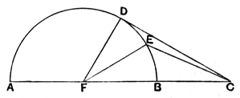
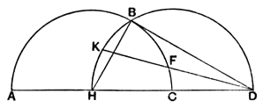

of the book: "La difficulté du dixiesme Livre d'Euclide est à plusieurs devenue en horreur, voire jusque à l'appeler la croix des mathématiciens, matière trop dure à digérer, et en la quelle n'aperçoivent aucune utilité," a passage quoted by Loria (*op. cit.*, p. 222).

It will naturally be asked, what use did the Greek geometers actually make of the theory of irrationals developed at such length in Book x.? The answer is that Euclid himself, in Book XIII., makes considerable use of the second portion of Book x. dealing with the irrationals affected with a negative sign, the apotomes etc. One object of Book XIII. is to investigate the relation of the sides of a pentagon inscribed in a circle and of an icosahedron and dodecahedron inscribed in a sphere to the diameter of the circle or sphere respectively, supposed rational. The connexion with the regular pentagon of a straight line cut in extreme and mean ratio is well known, and Euclid first proves (XIII. 6) that, if a *rational* straight line is so divided, the parts are the irrationals called *apotomes*, the lesser part being a *first apotome*. Then, on the assumption that the diameters of a circle and sphere respectively are rational, he proves (XIII. 11) that the side of the inscribed regular pentagon is the irrational straight line called *minor*, as is also the side of the inscribed icosahedron (XIII. 16), while the side of the inscribed dodecahedron is the irrational called an *apotome* (XIII. 17).

Of course the investigation in Book x. would not have been complete if it had dealt only with the irrationals affected with a *negative* sign. Those affected with the positive sign, the *binomials* etc., had also to be discussed, and we find both portions of Book x., with its nomenclature, made use of by Pappus in two propositions, of which it may be of interest to give the enunciations here.

If, says Pappus (IV. p. 178), $AB$ be the rational diameter of a semicircle, and if $AB$ be produced to $C$ so that $BC$ is equal to the radius, if $CD$ be a tangent,

if $E$ be the middle point of the arc $BD$, and if $CE$ be joined, then $CE$ is the irrational straight line called *minor*. As a matter of fact, if $\rho$ is the radius,
$$CE^2 = \rho^2 (5 - 2\sqrt{3}) \text{ and } CE = \sqrt{\frac{5 + \sqrt{13}}{2}} - \sqrt{\frac{5 - \sqrt{13}}{2}}.$$

If, again (p. 182), $CD$ be equal to the radius of a semicircle supposed

rational, and if the tangent $DB$ be drawn and the angle $ADB$ be bisected by $DF$ meeting the circumference in $F$, then $DF$ is the excess by which the binomial exceeds the *straight line which produces with a rational area a medial*
