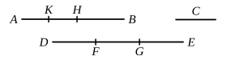

# BOOK X. PROPOSITIONS.

### PROPOSITION 1.

*Two unequal magnitudes being set out, if from the greater there be subtracted a magnitude greater than its half, and from that which is left a magnitude greater than its half, and if this process be repeated continually, there will be left some magnitude which will be less than the lesser magnitude set out.*

Let *AB*, *C* be two unequal magnitudes of which *AB* is the greater :
I say that, if from *AB* there be subtracted a magnitude greater than its half, and from that which is left a magnitude greater than its half, and if this process be repeated continually, there will be left some magnitude which will be less than the magnitude *C*.

For *C* if multiplied will sometime be greater than *AB*. [cf. v. Def. 4]
Let it be multiplied, and let *DE* be a multiple of *C*, and greater than *AB*;
let *DE* be divided into the parts *DF*, *FG*, *GE* equal to *C*,
from *AB* let there be subtracted *BH* greater than its half,
and, from *AH*, *HK* greater than its half,
and let this process be repeated continually until the divisions in *AB* are equal in multitude with the divisions in *DE*.

Let, then, *AK*, *KH*, *HB* be divisions which are equal in multitude with *DF*, *FG*, *GE*.

Now, since *DE* is greater than *AB*,
and from *DE* there has been subtracted *EG* less than its half,
and, from *AB*, *BH* greater than its half,
therefore the remainder *GD* is greater than the remainder *HA*.
