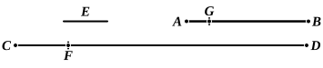

### PROPOSITION 2.

*If, when the less of two unequal magnitudes is continually subtracted in turn from the greater, that which is left never measures the one before it, the magnitudes will be incommensurable.*

For, there being two unequal magnitudes $AB$, $CD$, and $AB$ being the less, when the less is continually subtracted in turn from the greater, let that which is left over never measure the one before it;
I say that the magnitudes $AB$, $CD$ are incommensurable.

For, if they are commensurable, some magnitude will measure them.
Let a magnitude measure them, if possible, and let it be $E$;
let $AB$, measuring $FD$, leave $CF$ less than itself,
let $CF$ measuring $BG$, leave $AG$ less than itself,
and let this process be repeated continually, until there is left some magnitude which is less than $E$.

Suppose this done, and let there be left $AG$ less than $E$.

Then, since $E$ measures $AB$,
while $AB$ measures $DF$,
therefore $E$ will also measure $FD$.
But it measures the whole $CD$ also;
therefore it will also measure the remainder $CF$.
But $CF$ measures $BG$;
therefore $E$ also measures $BG$.
But it measures the whole $AB$ also;
therefore it will also measure the remainder $AG$, the greater the less :
which is impossible.

Therefore no magnitude will measure the magnitudes $AB$, $CD$;
therefore the magnitudes $AB$, $CD$ are incommensurable.

[x. Def. 1]

Therefore etc.
