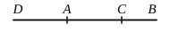

This proposition states the test for incommensurable magnitudes, founded on the usual operation for finding the greatest common measure. The sign of the incommensurability of two magnitudes is that this operation never comes to an end, while the successive remainders become smaller and smaller until they are less than any assigned magnitude.

Observe that Euclid says "let this process be repeated continually until there is left some magnitude which is less than $E$." Here he evidently assumes that the process *will* some time produce a remainder less than any assigned magnitude $E$. Now this is by no means self-evident, and yet Heiberg (though so careful to supply references) and Lorenz do not refer to the basis of the assumption, which is in reality X. 1, as Billingsley and Williamson were shrewd enough to see. The fact is that, if we set off a smaller magnitude once or oftener along a greater which it does not exactly measure, until the remainder is less than the smaller magnitude, we take away from the greater *more than its half*. Thus, in the figure, $FD$ is more than the half of $CD$, and $BG$ more than the half of $AB$. If we continued the process, $AG$ marked off along $CF$ as many times as possible would cut off more than its half; next, more than half $AG$ would be cut off, and so on. Hence along $CD$, $AB$ alternately the process would cut off more than half, then more than half the remainder and so on, so that on *both* lines we should ultimately arrive at a remainder less than any assigned length.

The method of finding the greatest common measure exhibited in this proposition and the next is of course again the same as that which we use and which may be shown thus :

$$
\begin{array}{r@{}l}
b) & \ a \ (p \\
   & \underline{pb} \\
   & c) \ b \ (q \\
   & \quad \underline{qc} \\
   & \quad d) \ c \ (r \\
   & \qquad \underline{rd} \\
   & \qquad e
\end{array}
$$

The proof too is the same as ours, taking just the same form, as shown in the notes to the similar propositions VII. 1, 2 above. In the present case the hypothesis is that the process never stops, and it is required to prove that *a*, *b* cannot in that case have any common measure, as *f*. For suppose that *f* is a common measure, and suppose the process to be continued until the remainder *e*, say, is less than *f*.

Then, since *f* measures *a*, *b*, it measures $a - pb$, or *c*.
Since *f* measures *b*, *c*, it measures $b - qc$, or *d*; and, since *f* measures *c*, *d*, it measures $c - rd$, or *e*: which is impossible, since $e < f$.

Euclid assumes as axiomatic that, if *f* measures *a*, *b*, it measures $ma \pm nb$.

In practice, of course, it is often unnecessary to carry the process far in order to see that it will never stop, and consequently that the magnitudes are incommensurable. A good instance is pointed out by Allman (*Greek Geometry from Thales to Euclid*, pp. 42, 137—8). Euclid proves in XIII. 5 that, if $AB$ be cut in extreme and mean ratio at $C$, and if $DA$ equal to $AC$ be added, then $DB$ is also cut in extreme and mean ratio at $A$. This is indeed obvious from the proof of II. 11. It follows conversely that, if $BD$ is cut into extreme and mean ratio at $A$, and $AC$, equal to the lesser segment $AD$, be subtracted from the greater $AB$, $AB$ is similarly divided at $C$. We can then

