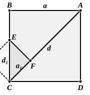

mark off from $AC$ a portion equal to $CB$, and $AC$ will then be similarly divided, and so on. Now the greater segment in a line thus divided is greater than half the line, but it follows from XIII. 3 that it is less than twice the lesser segment, i.e. the lesser segment can never be marked off more than *once* from the greater. Our process of marking off the lesser segment from the greater continually is thus exactly that of finding the greatest common measure. If, therefore, the segments were commensurable, the process would stop. But it clearly does not; therefore the segments are incommensurable.

Allman expresses the opinion that it was rather in connexion with the line cut in extreme and mean ratio than with reference to the diagonal and side of a square that the Pythagoreans discovered the incommensurable. But the evidence seems to put it beyond doubt that the Pythagoreans did discover the incommensurability of $\sqrt{2}$ and devoted much attention to this particular case. The view of Allman does not therefore commend itself to me, though it is likely enough that the Pythagoreans were aware of the incommensurability of the segments of a line cut in extreme and mean ratio. At all events the Pythagoreans could hardly have carried their investigations into the incommensurability of the segments of this line very far, since Theaetetus is said to have made the first classification of irrationals, and to him is also, with reasonable probability, attributed the substance of the first part of Eucl. XIII., in the sixth proposition of which occurs the proof that the segments of a rational straight line cut in extreme and mean ratio are *apotomes*.

Again, the incommensurability of $\sqrt{2}$ can be proved by a method practically equivalent to that of X. 2, and without carrying the process very far. This method is given in Chrystal's *Text-book of Algebra* (I. p. 270). Let $d$, $a$ be the diagonal and side respectively of a square ">$ABCD$. Mark off $AF$ along $AC$ equal to $a$. Draw $FE$ at right angles to $AC$ meeting $BC$ in $E$.

It is easily proved that
$$BE = EF = FC,$$
$$CF = AC - AB = d - a \dots\dots\dots\dots (1),$$
$$CE = CB - CF = a - (d - a)$$
$$\phantom{CE} = 2a - d \dots\dots\dots\dots (2).$$

Suppose, if possible, that $d$, $a$ are commensurable. If $d$, $a$ are both commensurably expressible in terms of any finite unit, each must be an integral multiple of a certain finite unit.
But from (1) it follows that $CF$, and from (2) it follows that $CE$, is an integral multiple of the same unit.

And $CF$, $CE$ are the side and diagonal of a square ">$CFEG$, the side of which is *less than half* the side of the original square. If $a_1$, $d_1$ are the side and diagonal of this square,
$$
\left.
\begin{aligned}
a_1 &= d - a \\
d_1 &= 2a - d
\end{aligned}
\right\}.
$$

Similarly we can form a square with side $a_2$ and diagonal $d_2$ which are less than half $a_1$, $d_1$ respectively, and $a_2$, $d_2$ must be integral multiples of the same unit, where
$$
\begin{aligned}
a_2 &= d_1 - a_1, \\
d_2 &= 2a_1 - d_1;
\end{aligned}
$$
