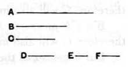

It is then proved that $d$ is a common measure of $a, b$; and next, by a _reductio ad absurdum_, that it is the _greatest_ common measure, since any common measure must measure $d$, and no magnitude greater than $d$ can measure $d$. The _reductio ad absurdum_ is of course one of form only.

The Porism corresponds exactly to the Porism to VII. 2.

The process of finding the greatest common measure is probably given in this Book, not only for the sake of completeness, but because in X. 5 a common measure of two magnitudes $A, B$ is assumed and used, and therefore it is important to show that such a measure can be _found_ if not already known.

---

### PROPOSITION 4.

_Given three commensurable magnitudes, to find their greatest common measure._

Let $A, B, C$ be the three given commensurable magnitudes; thus it is required to find the greatest common measure of $A, B, C$.

Let the greatest common measure of the two magnitudes $A, B$ be taken, and let it be $D$; [X. 3]  
then $D$ either measures $C$, or does not measure it.

First, let it measure it.

Since then $D$ measures $C$,  
while it also measures $A, B$,  
therefore $D$ is a common measure of $A, B, C$.

And it is manifest that it is also the greatest;  
for a greater magnitude than the magnitude $D$ does not measure $A, B$.

Next, let $D$ not measure $C$.

I say first that $C, D$ are commensurable.

For, since $A, B, C$ are commensurable,  
some magnitude will measure them,  
and this will of course measure $A, B$ also;  
so that it will also measure the greatest common measure of $A, B$, namely $D$. [X. 3, Por.]

But it also measures $C$;  
so that the said magnitude will measure $C, D$;  
therefore $C, D$ are commensurable.
