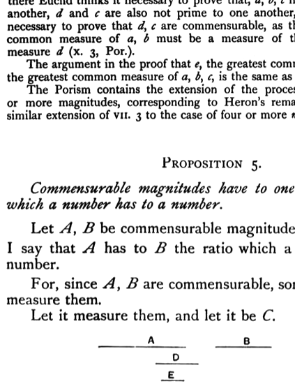

This proposition again corresponds exactly to VII. 3 for numbers. As there Euclid thinks it necessary to prove that, $a, b, c$ not being prime to one another, $d$ and $c$ are also not prime to one another, so here he thinks it necessary to prove that $d, c$ are commensurable, as they must be since any common measure of $a, b$ must be a measure of their greatest common measure $d$ (X. 3, Por.).

The argument in the proof that $e$, the greatest common measure of $d, c$, is the greatest common measure of $a, b, c$, is the same as that in VII. 3 and X. 3.

The Porism contains the extension of the process to the case of four or more magnitudes, corresponding to Heron's remark with regard to the similar extension of VII. 3 to the case of four or more _numbers_.

---

### PROPOSITION 5.

_Commensurable magnitudes have to one another the ratio which a number has to a number._

Let $A, B$ be commensurable magnitudes;  
I say that $A$ has to $B$ the ratio which a number has to a number.

For, since $A, B$ are commensurable, some magnitude will measure them.  
Let it measure them, and let it be $C$.

And, as many times as $C$ measures $A$, so many units let there be in $D$;  
and, as many times as $C$ measures $B$, so many units let there be in $E$.

Since then $C$ measures $A$ according to the units in $D$,  
while the unit also measures $D$ according to the units in it,  
therefore the unit measures the number $D$ the same number of times as the magnitude $C$ measures $A$;  
therefore, as $C$ is to $A$, so is the unit to $D$; [VII. Def. 20]  
therefore, inversely, as $A$ is to $C$, so is $D$ to the unit. [cf. V. 7, Por.]

Again, since $C$ measures $B$ according to the units in $E$,  
while the unit also measures $E$ according to the units in it,
