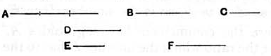

### PROPOSITION 6.

_If two magnitudes have to one another the ratio which a number has to a number, the magnitudes will be commensurable._

For let the two magnitudes $A, B$ have to one another the ratio which the number $D$ has to the number $E$;  
5 I say that the magnitudes $A, B$ are commensurable.

For let $A$ be divided into as many equal parts as there are units in $D$,  
and let $C$ be equal to one of them;  
and let $F$ be made up of as many magnitudes equal to $C$ as  
10 there are units in $E$.

Since then there are in $A$ as many magnitudes equal to $C$ as there are units in $D$,  
whatever part the unit is of $D$, the same part is $C$ of $A$ also;  
therefore, as $C$ is to $A$, so is the unit to $D$. [VII. Def. 20]  
15 But the unit measures the number $D$;  
therefore $C$ also measures $A$.[^27_1]

And since, as $C$ is to $A$, so is the unit to $D$,  
therefore, inversely, as $A$ is to $C$, so is the number $D$ to the unit. [cf. V. 7, Por.]

20 Again, since there are in $F$ as many magnitudes equal to $C$ as there are units in $E$,  
therefore, as $C$ is to $F$, so is the unit to $E$. [VII. Def. 20]

But it was also proved that,  
as $A$ is to $C$, so is $D$ to the unit;  
25 therefore, _ex aequali_, as $A$ is to $F$, so is $D$ to $E$. [V. 22]

But, as $D$ is to $E$, so is $A$ to $B$;  
therefore also, as $A$ is to $B$, so is it to $F$ also. [V. 11]

Therefore $A$ has the same ratio to each of the magnitudes $B, F$;  
30 therefore $B$ is equal to $F$. [V. 9]

But $C$ measures $F$;  
therefore it measures $B$ also.

Further it measures $A$ also;  
therefore $C$ measures $A, B$.
