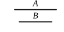

### PROPOSITION 7.

Incommensurable magnitudes have not to one another the 
ratio which a number has to a number.

Let $A$, $B$ be incommensurable magnitudes; 
I say that $A$ has not to $B$ the ratio which a number has to a 
number.

For, if $A$ has to $B$ the ratio which a number has to a 
number, $A$ will be commensurable with $B$. [X. 6]

But it is not;

therefore $A$ has not to $B$ the ratio which a 
number has to a number.

Therefore etc.

### PROPOSITION 8.

If two magnitudes have not to one another the ratio which 
a number has to a number, the magnitudes will be incom- 
mensurable.

For let the two magnitudes $A$, $B$ not have to one another 
the ratio which a number has to a number; 
I say that the magnitudes $A$, $B$ are incom- 
mensurable.

For, if they are commensurable, $A$ will have to $B$ the 
ratio which a number has to a number. [X. 5]

But it has not;

therefore the magnitudes $A$, $B$ are incommensurable.

Therefore etc.

### PROPOSITION 9.

The squares on straight lines commensurable in length have 
to one another the ratio which a square number has to a square 
number; and squares which have to one another the ratio 
which a square number has to a square number will also have 
their sides commensurable in length. But the squares on 
straight lines incommensurable in length have not to one 
another the ratio which a square number has to a square 
number; and squares which have not to one another the ratio 
which a square number has to a square number will not have 
their sides commensurable in length either.

