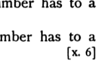
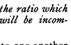

### PROPOSITION 7.

*Incommensurable magnitudes have not to one another the ratio which a number has to a number.*

Let $A$, $B$ be incommensurable magnitudes;
I say that $A$ has not to $B$ the ratio which a number has to a number.

For, if $A$ has to $B$ the ratio which a number has to a number, $A$ will be commensurable with $B$.
[x. 6]

But it is not;
therefore $A$ has not to $B$ the ratio which a number has to a number.

Therefore etc.

### PROPOSITION 8.

*If two magnitudes have not to one another the ratio which a number has to a number, the magnitudes will be incommensurable.*

For let the two magnitudes $A$, $B$ not have to one another the ratio which a number has to a number;
I say that the magnitudes $A$, $B$ are incommensurable.

For, if they are commensurable, $A$ will have to $B$ the ratio which a number has to a number.
[x. 5]

But it has not;
therefore the magnitudes $A$, $B$ are incommensurable.

Therefore etc.

### PROPOSITION 9.

*The squares on straight lines commensurable in length have to one another the ratio which a square number has to a square number; and squares which have to one another the ratio which a square number has to a square number will also have their sides commensurable in length. But the squares on straight lines incommensurable in length have not to one another the ratio which a square number has to a square number; and squares which have not to one another the ratio which a square number has to a square number will not have their sides commensurable in length either.*
