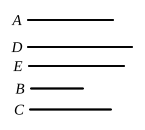

another the ratio which a square number has to a square number, that is, which are not similar plane numbers;
and let it be contrived that,
as $B$ is to $C$, so is the square on $A$ to the square on $D$
—for we have learnt how to do this—
[x. 6, Por.]
therefore the square on $A$ is commensurable with the square on $D$.
[x. 6]

And, since $B$ has not to $C$ the ratio which a square number has to a square number,
therefore neither has the square on $A$ to the square on $D$ the ratio which a square number has to a square number;
therefore $A$ is incommensurable in length with $D$.
[x. 9]

Let $E$ be taken a mean proportional between $A$, $D$;
therefore, as $A$ is to $D$, so is the square on $A$ to the square on $E$.
[v. Def. 9]

But $A$ is incommensurable in length with $D$;
therefore the square on $A$ is also incommensurable with the square on $E$;
[x. 11]
therefore $A$ is incommensurable in square with $E$.

Therefore two straight lines $D$, $E$ have been found incommensurable, $D$ in length only, and $E$ in square and of course in length also, with the assigned straight line $A$.]

---

It would appear as though this proposition was intended to supply a justification for the statement in X. Def. 3 that it is *proved* that there are an infinite number of straight lines ($a$) incommensurable in length only, or commensurable in square only, and ($b$) incommensurable in square, with any given straight line.

But in truth the proposition could well be dispensed with; and the positive objections to its genuineness are considerable.

In the first place, it depends on the following proposition, X. 11; for the last step concludes that, since
$$a^2 : y^2 = a : x,$$
and $a$, $x$ are incommensurable in length, therefore $a^2$, $y^2$ are incommensurable. But Euclid never commits the irregularity of proving a theorem by means of a later one. Gregory sought to get over the difficulty by putting X. 10 after X. 11; but of course, if the order were so inverted, the Lemma would still be in the wrong place.

Further, the expression ἐμάθομεν γάρ, "for we have learnt (how to do this)," is not in Euclid's manner and betrays the hand of a learner (though the same
