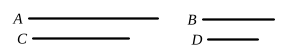

expression is found in the *Sectio Canonis* of Euclid, where the reference is to the *Elements*).

Lastly the manuscript P has the number 10, in the first hand, at the top of X. 11, from which it may perhaps be concluded that X. 10 had at first no number.

It seems best therefore to reject as spurious both the Lemma and X. 10.

The argument of X. 10 is simple. If $a$ be a given straight line and $m$, $n$ numbers which have not to one another the ratio of square to square, take $x$ such that
$$a^2 : x^2 = m : n, \qquad \text{[x. 6, Por.]}$$
whence $a$, $x$ are incommensurable in length.
[x. 9]

Then take $y$ a mean proportional between $a$, $x$, whence
$$a^2 : y^2 = a : x \qquad \text{[v. Def. 9]}$$
$$[= \sqrt{m} : \sqrt{n}],$$
and $x$ is incommensurable in length only, while $y$ is incommensurable in square as well as in length, with $a$.

---

### PROPOSITION 11.

*If four magnitudes be proportional, and the first be commensurable with the second, the third will also be commensurable with the fourth; and, if the first be incommensurable with the second, the third will also be incommensurable with the fourth.*

Let $A$, $B$, $C$, $D$ be four magnitudes in proportion, so that, as $A$ is to $B$, so is $C$ to $D$,
and let $A$ be commensurable with $B$;
I say that $C$ will also be commensurable with $D$.

For, since $A$ is commensurable with $B$,
therefore $A$ has to $B$ the ratio which a number has to a number.
[x. 5]

And, as $A$ is to $B$, so is $C$ to $D$;
therefore $C$ also has to $D$ the ratio which a number has to a number;
therefore $C$ is commensurable with $D$.
[x. 6]

Next, let $A$ be incommensurable with $B$;
I say that $C$ will also be incommensurable with $D$.

For, since $A$ is incommensurable with $B$,
therefore $A$ has not to $B$ the ratio which a number has to a number.
[x. 7]
