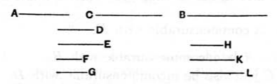

And, as $A$ is to $B$, so is $C$ to $D$;
therefore neither has $C$ to $D$ the ratio which a number has to a number;
therefore $C$ is incommensurable with $D$.
[x. 8]

Therefore etc.

---

I shall henceforth, for the sake of brevity, use symbols for the terms "commensurable (with)" and "incommensurable (with)" according to the varieties described in X. Deff. 1—4. The symbols are taken from Lorenz and seem convenient.

*Commensurable* and *commensurable with*, in relation to areas, and *commensurable in length* and *commensurable in length with*, in relation to straight lines, will be denoted by $\frown$.

*Commensurable in square only* or *commensurable in square only with* (terms applicable only to straight lines) will be denoted by $\sim$.

*Incommensurable (with)*, of areas, and *incommensurable (with)*, of straight lines will be denoted by $\smile$.

*Incommensurable in square (with)* (a term applicable to straight lines only) will be denoted by $\sim\hspace{-0.5em}-$.

Suppose $a$, $b$, $c$, $d$ to be four magnitudes such that
$$a : b = c : d.$$
Then (1), if $a \frown b$,
$$a : b = m : n, \quad \text{where } m, n \text{ are integers, [x. 5]}$$
whence
$$c : d = m : n,$$
and therefore
$$c \frown d. \quad \text{[x. 6]}$$
(2) If $a \smile b$,
$$a : b \neq m : n, \quad \text{[x. 7]}$$
so that
$$c : d \neq m : n,$$
whence
$$c \smile d. \quad \text{[x. 8]}$$

---

### PROPOSITION 12.

*Magnitudes commensurable with the same magnitude are commensurable with one another also.*

For let each of the magnitudes $A$, $B$ be commensurable with $C$;
I say that $A$ is also commensurable with $B$.

For, since $A$ is commensurable with $C$,
therefore $A$ has to $C$ the ratio which a number has to a number.
[x. 5]
