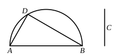

### PROPOSITION 13.

*If two magnitudes be commensurable, and the one of them
be incommensurable with any magnitude, the remaining one
will also be incommensurable with the same.*

Let $A$, $B$ be two commensurable magnitudes, and let one
of them, $A$, be incommensurable with
any other magnitude $C$;
I say that the remaining one, $B$, will
also be incommensurable with $C$.

For, if $B$ is commensurable with $C$,
while $A$ is also commensurable with $B$,
$A$ is also commensurable with $C$. [x. 12]
But it is also incommensurable with it:
which is impossible.

Therefore $B$ is not commensurable with $C$;
therefore it is incommensurable with it.

Therefore etc.

### LEMMA.

*Given two unequal straight lines, to find by what square the
square on the greater is greater than the square on the less.*

Let $AB$, $C$ be the given two unequal straight lines, and
let $AB$ be the greater of them;
thus it is required to find by what
square the square on $AB$ is greater
than the square on $C$.

Let the semicircle $ADB$ be de-
scribed on $AB$,
and let $AD$ be fitted into it equal to $C$; [iv. 1]
let $DB$ be joined.

It is then manifest that the angle $ADB$ is right, [iii. 31]
and that the square on $AB$ is greater than the square on
$AD$, that is, $C$, by the square on $DB$. [i. 47]

Similarly also, if two straight lines be given, the straight
line the square on which is equal to the sum of the squares
on them is found in this manner.
