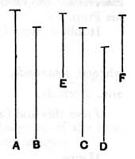

Let $AD$, $DB$ be the given two straight lines, and let it be
required to find the straight line the square on which is equal
to the sum of the squares on them.

Let them be placed so as to contain a right angle, that
formed by $AD$, $DB$;
and let $AB$ be joined.

It is again manifest that the straight line the square on
which is equal to the sum of the squares on $AD$, $DB$ is $AB$.
[i. 47]

Q. E. D.

---

The lemma gives an obvious method of finding a straight line ($c$) equal to
$\sqrt{a^2 \mp b^2}$, where $a$, $b$ are given straight lines of which $a$ is the greater.

---

### PROPOSITION 14.

*If four straight lines be proportional, and the square on
the first be greater than the square on the second by the square
on a straight line commensurable with the first, the square on
the third will also be greater than the square on the fourth by*
5 *the square on a straight line commensurable with the third.*

*And, if the square on the first be greater than the square
on the second by the square on a straight line incommensurable
with the first, the square on the third will also be greater than
the square on the fourth by the square on a straight line in-*
10 *commensurable with the third.*

Let $A$, $B$, $C$, $D$ be four straight lines in proportion, so
that, as $A$ is to $B$, so is $C$ to $D$;
and let the square on $A$ be greater than
the square on $B$ by the square on $E$, and
15 let the square on $C$ be greater than the
square on $D$ by the square on $F$;
I say that, if $A$ is commensurable with $E$,
$C$ is also commensurable with $F$,
and, if $A$ is incommensurable with $E$, $C$ is
20 also incommensurable with $F$.

For since, as $A$ is to $B$, so is $C$ to $D$,
therefore also, as the square on $A$ is to the square on $B$, so is
the square on $C$ to the square on $D$. [vi. 22]

But the squares on $E$, $B$ are equal to the square on $A$,
25 and the squares on $D$, $F$ are equal to the square on $C$.
