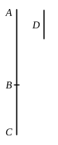

### PROPOSITION 16.

If two incommensurable magnitudes be added together, the 
whole will also be incommensurable with each of them; and, if 
the whole be incommensurable with one of them, the original 
magnitudes will also be incommensurable.

For let the two incommensurable magnitudes $AB$, $BC$ be 
added together; 
I say that the whole $AC$ is also incommensurable 
with each of the magnitudes $AB$, $BC$.

For, if $CA$, $AB$ are not incommensurable, some 
magnitude will measure them. 
Let it measure them, if possible, and let it be $D$.

Since then $D$ measures $CA$, $AB$,

therefore it will also measure the remainder $BC$.

But it measures $AB$ also;

therefore $D$ measures $AB$, $BC$.

Therefore $AB$, $BC$ are commensurable;

but they were also, by hypothesis, incommensurable:

which is impossible.

Therefore no magnitude will measure $CA$, $AB$; 
therefore $CA$, $AB$ are incommensurable. [X. Def. 1]

Similarly we can prove that $AC$, $CB$ are also incom- 
mensurable.

Therefore $AC$ is incommensurable with each of the magni- 
tudes $AB$, $BC$.

Next, let $AC$ be incommensurable with one of the magni- 
tudes $AB$, $BC$.

First, let it be incommensurable with $AB$; 
I say that $AB$, $BC$ are also incommensurable.

For, if they are commensurable, some magnitude will 
measure them. 
Let it measure them, and let it be $D$.

Since then $D$ measures $AB$, $BC$,

therefore it will also measure the whole $AC$.

But it measures $AB$ also;

therefore $D$ measures $CA$, $AB$.

