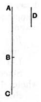

### PROPOSITION 16.

*If two incommensurable magnitudes be added together, the
whole will also be incommensurable with each of them; and, if
the whole be incommensurable with one of them, the original
magnitudes will also be incommensurable.*

For let the two incommensurable magnitudes $AB$, $BC$ be
added together;
I say that the whole $AC$ is also incommensurable
with each of the magnitudes $AB$, $BC$.

For, if $CA$, $AB$ are not incommensurable, some
magnitude will measure them.
Let it measure them, if possible, and let it be $D$.
Since then $D$ measures $CA$, $AB$,
therefore it will also measure the remainder $BC$.
But it measures $AB$ also;
therefore $D$ measures $AB$, $BC$.
Therefore $AB$, $BC$ are commensurable;
but they were also, by hypothesis, incommensurable:
which is impossible.
Therefore no magnitude will measure $CA$, $AB$;
therefore $CA$, $AB$ are incommensurable. [x. Def. 1]

Similarly we can prove that $AC$, $CB$ are also incom-
mensurable.
Therefore $AC$ is incommensurable with each of the magni-
tudes $AB$, $BC$.

Next, let $AC$ be incommensurable with one of the magni-
tudes $AB$, $BC$.
First, let it be incommensurable with $AB$;
I say that $AB$, $BC$ are also incommensurable.
For, if they are commensurable, some magnitude will
measure them.
Let it measure them, and let it be $D$.
Since then $D$ measures $AB$, $BC$,
therefore it will also measure the whole $AC$.
But it measures $AB$ also;
therefore $D$ measures $CA$, $AB$.
