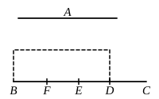

10 the greater, and if there be applied to the greater a parallelogram 
equal to the fourth part of the square on the less and deficient 
by a square figure, it will divide it into parts which are com- 
mensurable in length.

Let $A$, $BC$ be two unequal straight lines, of which $BC$ is 
15 the greater, 
and let there be applied to $BC$ a parallel- 
ogram equal to the fourth part of the 
square on the less, $A$, that is, equal to 
the square on the half of $A$, and deficient 
20 by a square figure. Let this be the 
rectangle $BD$, $DC$, [cf. Lemma] 
and let $BD$ be commensurable in length with $DC$; 
I say that the square on $BC$ is greater than the square on $A$ 
by the square on a straight line commensurable with $BC$.

25 For let $BC$ be bisected at the point $E$, 
and let $EF$ be made equal to $DE$.

Therefore the remainder $DC$ is equal to $BF$.

And, since the straight line $BC$ has been cut into equal 
parts at $E$, and into unequal parts at $D$,

30 therefore the rectangle contained by $BD$, $DC$, together with 
the square on $ED$, is equal to the square on $EC$; [II. 5]

And the same is true of their quadruples;

therefore four times the rectangle $BD$, $DC$, together with 
four times the square on $DE$, is equal to four times the square 
35 on $EC$.

But the square on $A$ is equal to four times the rectangle 
$BD$, $DC$; 
and the square on $DF$ is equal to four times the square on 
$DE$, for $DF$ is double of $DE$.

40 And the square on $BC$ is equal to four times the square 
on $EC$, for again $BC$ is double of $CE$.

Therefore the squares on $A$, $DF$ are equal to the square 
on $BC$, 
so that the square on $BC$ is greater than the square on $A$ by 
45 the square on $DF$.

It is to be proved that $BC$ is also commensurable with $DF$.

Since $BD$ is commensurable in length with $DC$,

therefore $BC$ is also commensurable in length with $CD$. [X. 15]

