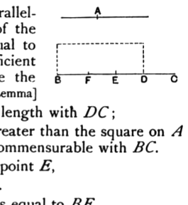

10 the greater, and if there be applied to the greater a parallelogram equal to the fourth part of the square on the less and deficient by a square figure, it will divide it into parts which are commensurable in length.

Let *A*, *BC* be two unequal straight lines, of which *BC* is 15 the greater, and let there be applied to *BC* a parallelogram equal to the fourth part of the square on the less, *A*, that is, equal to the square on the half of *A*, and deficient 20 by a square figure. Let this be the rectangle *BD*, *DC*, [cf. Lemma] and let *BD* be commensurable in length with *DC*;
I say that the square on *BC* is greater than the square on *A* by the square on a straight line commensurable with *BC*.

25 For let *BC* be bisected at the point *E*, and let *EF* be made equal to *DE*.
Therefore the remainder *DC* is equal to *BF*.
And, since the straight line *BC* has been cut into equal parts at *E*, and into unequal parts at *D*, 30 therefore the rectangle contained by *BD*, *DC*, together with the square on *ED*, is equal to the square on *EC*; [II. 5]
And the same is true of their quadruples; therefore four times the rectangle *BD*, *DC*, together with four times the square on *DE*, is equal to four times the square 35 on *EC*.
But the square on *A* is equal to four times the rectangle *BD*, *DC*; and the square on *DF* is equal to four times the square on *DE*, for *DF* is double of *DE*.
40 And the square on *BC* is equal to four times the square on *EC*, for again *BC* is double of *CE*.
Therefore the squares on *A*, *DF* are equal to the square on *BC*, so that the square on *BC* is greater than the square on *A* by 45 the square on *DF*.
It is to be proved that *BC* is also commensurable with *DF*.
Since *BD* is commensurable in length with *DC*, therefore *BC* is also commensurable in length with *CD*. [X. 15]
