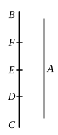

It is often more convenient to use the symmetrical form of equation in 
this and similar cases, viz.
$$\left.\begin{aligned} xy &= \frac{b^2}{4} \\ x + y &= a \end{aligned}\right\}$$
The result with this mode of expression is that 
(1) if $x \mathrel{⌢} y$, then $a \mathrel{⌢} \sqrt{a^2 - b^2}$; and 
(2) if $a \mathrel{⌢} \sqrt{a^2 - b^2}$, then $x \mathrel{⌢} y$. 
The truth of the proposition is even easier to see in this case, since 
$(x - y)^2 = (a^2 - b^2)$.

---

### PROPOSITION 18.

If there be two unequal straight lines, and to the greater 
there be applied a parallelogram equal to the fourth part of 
the square on the less and deficient by a square figure, and 
if it divide it into parts which are incommensurable, the square 
5 on the greater will be greater than the square on the less by 
the square on a straight line incommensurable with the greater.

And, if the square on the greater be greater than the square 
on the less by the square on a straight line incommensurable 
with the greater, and if there be applied to the greater a 
10 parallelogram equal to the fourth part of the square on the 
less and deficient by a square figure, it divides it into parts 
which are incommensurable.

Let $A$, $BC$ be two unequal straight lines, of which $BC$ is 
the greater, 
and to $BC$ let there be applied a parallelogram equal 
to the fourth part of the square on the less, $A$, and 
deficient by a square figure. Let this be the rect- 
angle $BD$, $DC$, [cf. Lemma before X. 17] 
and let $BD$ be incommensurable in length with $DC$; 
I say that the square on $BC$ is greater than the 
square on $A$ by the square on a straight line incom- 
mensurable with $BC$.

For, with the same construction as before, we can prove 
similarly that the square on $BC$ is greater than the square on 
$A$ by the square on $FD$.

It is to be proved that $BC$ is incommensurable in length 
with $FD$.
