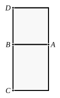

### PROPOSITION 20.

*If a rational area be applied to a rational straight line, it produces as breadth a straight line rational and commensurable in length with the straight line to which it is applied.*

For let the rational area *AC* be applied to *AB*, a straight line once more rational in any of the aforesaid ways, producing *BC* as breadth;
I say that *BC* is rational and commensurable in length with *BA*.
For on *AB* let the square *AD* be described;
therefore *AD* is rational. [X. Def. 4]
But *AC* is also rational;
therefore *DA* is commensurable with *AC*.
And, as *DA* is to *AC*, so is *DB* to *BC*. [VI. 1]
Therefore *DB* is also commensurable with *BC*; [X. 11]
and *DB* is equal to *BA*;
therefore *AB* is also commensurable with *BC*.
But *AB* is rational;
therefore *BC* is also rational and commensurable in length with *AB*.

Therefore etc.

---

The converse of the last. If $\rho$ is a rational straight line, any rational area is of the form $k\rho^2$. If this be "applied" to $\rho$, the breadth is $k\rho$ commensurable in length with $\rho$ and therefore rational. We should reach the same result if we applied the area to *another* rational straight line $\sigma$. The breadth is then
$$\frac{k\rho^2}{\sigma} = \frac{k\rho^2}{\sigma^2}\cdot \sigma = \frac{m}{n}k\cdot \sigma \text{ or } k'\sigma\text{, say.}$$

---

### PROPOSITION 21.

*The rectangle contained by rational straight lines commensurable in square only is irrational, and the side of the square equal to it is irrational. Let the latter be called medial.*

For let the rectangle *AC* be contained by the rational straight lines *AB*, *BC* commensurable in square only;
