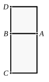
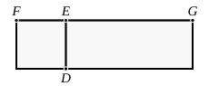

I say that *AC* is irrational, and the side of the square equal to it is irrational;
and let the latter be called **medial**.

For on *AB* let the square *AD* be described;
therefore *AD* is rational. [x. Def. 4]
And, since *AB* is incommensurable in length with *BC*,
for by hypothesis they are commensurable in square only,
while *AB* is equal to *BD*,
therefore *DB* is also incommensurable in length with *BC*.
And, as *DB* is to *BC*, so is *AD* to *AC*; [VI. 1]
therefore *DA* is incommensurable with *AC*. [x. 11]
But *DA* is rational;
therefore *AC* is irrational,
so that the side of the square equal to *AC* is also irrational. [x. Def. 4]
And let the latter be called **medial**.

Q. E. D.

---

A *medial* straight line, now defined for the first time, is so called because it is a mean proportional between two rational straight lines commensurable in square only. Such straight lines can be denoted by $\rho$, $\rho \sqrt{k}$. A medial straight line is therefore of the form $\sqrt{\rho^2 \sqrt{k}}$ or $k^{\frac{1}{4}} \rho$. Euclid's proof that this is irrational is equivalent to the following. Take $\rho$, $\rho \sqrt{k}$ commensurable in square only, so that they are incommensurable in length.

Now
$$\rho : \rho \sqrt{k} = \rho^2 : \rho^2 \sqrt{k},$$
whence [x. 11] $\rho^2 \sqrt{k}$ is incommensurable with $\rho^2$ and therefore irrational [x. Def. 4], so that $\sqrt{\rho^2 \sqrt{k}}$ is also irrational [ibid.].

A medial straight line may evidently take either of the forms $\sqrt{a\sqrt{B}}$ or $\sqrt[4]{AB}$, where of course $B$ is not of the form $k^2 A$.

---

#### Lemma.

*If there be two straight lines, then, as the first is to the second, so is the square on the first to the rectangle contained by the two straight lines.*

Let *FE*, *EG* be two straight lines.
I say that, as *FE* is to *EG*, so is the square on *FE* to the rectangle *FE*, *EG*.
