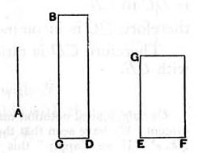

For on *FE* let the square *DF* be described, and let *GD* be completed.
Since then, as *FE* is to *EG*, so is *FD* to *DG*, [VI. 1]
and *FD* is the square on *FE*,
and *DG* the rectangle *DE*, *EG*, that is, the rectangle *FE*, *EG*,
therefore, as *FE* is to *EG*, so is the square on *FE* to the rectangle *FE*, *EG*.
Similarly also, as the rectangle *GE*, *EF* is to the square on *EF*, that is, as *GD* is to *FD*, so is *GE* to *EF*.

Q. E. D.

---

If $a$, $b$ be two straight lines,
$$a : b = a^2 : ab.$$

---

### Proposition 22.

*The square on a medial straight line, if applied to a rational straight line, produces as breadth a straight line rational and incommensurable in length with that to which it is applied.*

Let *A* be medial and *CB* rational,
and let a rectangular area *BD* equal to the square on *A* be applied to *BC*, producing *CD* as breadth;
I say that *CD* is rational and incommensurable in length with *CB*.
For, since *A* is medial, the square on it is equal to a rectangular area contained by rational straight lines commensurable in square only. [x. 21]
Let the square on it be equal to *GF*.
But the square on it is also equal to *BD*;
therefore *BD* is equal to *GF*.
But it is also equiangular with it;
and in equal and equiangular parallelograms the sides about the equal angles are reciprocally proportional; [VI. 14]
therefore, proportionally, as *BC* is to *EG*, so is *EF* to *CD*.
Therefore also, as the square on *BC* is to the square on *EG*, so is the square on *EF* to the square on *CD*. [VI. 22]
