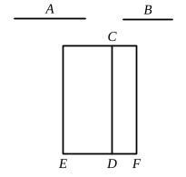

And $k\rho^2$ is rational,
therefore $x^2$, and therefore $x$, is rational. [x. Def. 4]

(2) Since $\sqrt{k} \cdot \rho \sim \rho$, $\sqrt{k} \cdot \rho \smile \rho$.
But [Lemma]
$$\sqrt{k} \cdot \rho : \rho = k\rho^2 : \sqrt{k} \cdot \rho^2,$$
whence
$$k\rho^2 \smile \sqrt{k} \cdot \rho^2. \qquad \text{[x. 11]}$$
But $\sqrt{k} \cdot \rho^2 = \sigma x$, and $k\rho^2 \sim x^2$ (from above);
therefore
$$x^2 \smile \sigma x; \qquad \text{[x. 13]}$$
and, since $x^2 : \sigma x = x : \sigma$, [Lemma]
$$x \smile \sigma.$$

---

### Proposition 23.

*A straight line commensurable with a medial straight line is medial.*

Let $A$ be medial, and let $B$ be commensurable with $A$;
I say that $B$ is also medial.

For let a rational straight line $CD$ be set out,
and to $CD$ let the rectangular area ">$CE$ equal to the square on $A$ be applied, producing $ED$ as breadth;
therefore $ED$ is rational and incommensurable in length with $CD$. [x. 22]
And let the rectangular area ">$CF$ equal to the square on $B$ be applied to $CD$, producing $DF$ as breadth.
Since then $A$ is commensurable with $B$,
the square on $A$ is also commensurable with the square on $B$.
But ">$EC$ is equal to the square on $A$,
and ">$CF$ is equal to the square on $B$;
therefore ">$EC$ is commensurable with ">$CF$.
And, as ">$EC$ is to ">$CF$, so is $ED$ to $DF$; [VI. 1]
therefore $ED$ is commensurable in length with $DF$. [x. 11]
But $ED$ is rational and incommensurable in length with $DC$;
therefore $DF$ is also rational [x. Def. 3] and incommensurable in length with $DC$. [x. 13]
Therefore $CD$, $DF$ are rational and commensurable in square only.
