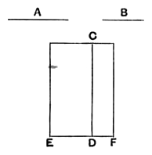

And $k\rho^2$ is rational,
therefore $x^2$, and therefore $x$, is rational. [x. Def. 4]

(2) Since $\sqrt{k} \cdot \rho \sim \rho$, $\sqrt{k} \cdot \rho \smile \rho$.
But [Lemma]
$$\sqrt{k} \cdot \rho : \rho = k\rho^2 : \sqrt{k} \cdot \rho^2,$$
whence
$$k\rho^2 \smile \sqrt{k} \cdot \rho^2. \qquad \text{[x. 11]}$$
But $\sqrt{k} \cdot \rho^2 = \sigma x$, and $k\rho^2 \sim x^2$ (from above);
therefore
$$x^2 \smile \sigma x; \qquad \text{[x. 13]}$$
and, since $x^2 : \sigma x = x : \sigma$, [Lemma]
$$x \smile \sigma.$$

---

### Proposition 23.

*A straight line commensurable with a medial straight line is medial.*

Let *A* be medial, and let *B* be commensurable with *A*;
I say that *B* is also medial.

For let a rational straight line *CD* be set out,
and to *CD* let the rectangular area *CE* equal to the square on *A* be applied, producing *ED* as breadth;
therefore *ED* is rational and incommensurable in length with *CD*. [x. 22]
And let the rectangular area *CF* equal to the square on *B* be applied to *CD*, producing *DF* as breadth.
Since then *A* is commensurable with *B*,
the square on *A* is also commensurable with the square on *B*.
But *EC* is equal to the square on *A*,
and *CF* is equal to the square on *B*;
therefore *EC* is commensurable with *CF*.
And, as *EC* is to *CF*, so is *ED* to *DF*; [VI. 1]
therefore *ED* is commensurable in length with *DF*. [x. 11]
But *ED* is rational and incommensurable in length with *DC*;
therefore *DF* is also rational [x. Def. 3] and incommensurable in length with *DC*. [x. 13]
Therefore *CD*, *DF* are rational and commensurable in square only.
