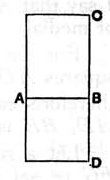

whence the area $\lambda^2 \sqrt{k} \cdot \rho^2$ (or $\lambda \sqrt{k} \cdot \rho^2$) is contained by two rational straight lines commensurable in square only, so that $\lambda k^{\frac{1}{4}} \rho$ (or $\sqrt{\lambda} \cdot k^{\frac{1}{4}} \rho$) is a medial straight line.

It is in the Porism that we have the first mention of a *medial area*. It is the area which is equal to the square on a medial straight line, an area, therefore, of the form $k^{\frac{1}{2}} \rho^2$, which is, as a matter of fact, arrived at, though not named, before the *medial straight line* itself (x. 21).

The Porism states that $\lambda k^{\frac{1}{2}} \rho^2$ is a medial area, which is indeed obvious.

---

### Proposition 24.

*The rectangle contained by medial straight lines commensurable in length is medial.*

For let the rectangle *AC* be contained by the medial straight lines *AB*, *BC* which are commensurable in length;
I say that *AC* is medial.

For on *AB* let the square *AD* be described;
therefore *AD* is medial.
And, since *AB* is commensurable in length with *BC*,
while *AB* is equal to *BD*,
therefore *DB* is also commensurable in length with *BC*;
so that *DA* is also commensurable with *AC*. [VI. 1, x. 11]
But *DA* is medial;
therefore *AC* is also medial. [x. 23, Por.]

Q. E. D.

---

There is the same difficulty in the text of this enunciation as in that of X. 19. The Greek says "medial straight lines commensurable in length in any of the aforesaid ways"; but straight lines can only be *commensurable in length* in one way, though they can be medial in two ways, as explained in the addition to the preceding proposition, i.e. they can be either commensurable in length or commensurable in square only with a *given* medial straight line. For the same reason as that explained in the note on X. 19 I have omitted "in any of the aforesaid ways" in the enunciation and bracketed the addition to X. 23 to which it refers.

$k^{\frac{1}{4}} \rho$ and $\lambda k^{\frac{1}{4}} \rho$ are medial straight lines commensurable in length. The rectangle contained by them is $\lambda k^{\frac{1}{2}} \rho^2$, which may be written $k'^{\frac{1}{2}} \rho'^2$ and is therefore clearly medial.

Euclid's proof proceeds thus. Let $x$, $\lambda x$ be the two medial straight lines commensurable in length.
Therefore
$$x^2 : x \cdot \lambda x = x : \lambda x.$$
