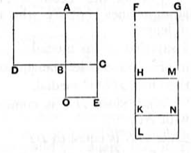

But $x \sim \lambda x$, so that $x^2 \sim x \cdot \lambda x$. [x. 11]
Now $x^2$ is medial [x. 21];
therefore $x \cdot \lambda x$ is also medial. [x. 23, Por.]

We may of course write two medial straight lines commensurable in length in the forms $m k^{\frac{1}{4}} \rho$, $n k^{\frac{1}{4}} \rho$; and these may either be $m \sqrt{a\sqrt{B}}$, $n \sqrt{a\sqrt{B}}$, or $m \sqrt[4]{AB}$, $n \sqrt[4]{AB}$.

---

### Proposition 25.

*The rectangle contained by medial straight lines commensurable in square only is either rational or medial.*

For let the rectangle *AC* be contained by the medial straight lines *AB*, *BC* which are commensurable in square only;
I say that *AC* is either rational or medial.

For on *AB*, *BC* let the squares *AD*, *BE* be described;
therefore each of the squares *AD*, *BE* is medial.
Let a rational straight line *FG* be set out,
to *FG* let there be applied the rectangular parallelogram *GH* equal to *AD*, producing *FH* as breadth,
to *HM* let there be applied the rectangular parallelogram *MK* equal to *AC*, producing *HK* as breadth,
and further to *KN* let there be similarly applied *NL* equal to *BE*, producing *KL* as breadth;
therefore *FH*, *HK*, *KL* are in a straight line.
Since then each of the squares *AD*, *BE* is medial,
and *AD* is equal to *GH*, and *BE* to *NL*,
therefore each of the rectangles *GH*, *NL* is also medial.
And they are applied to the rational straight line *FG*;
therefore each of the straight lines *FH*, *KL* is rational and incommensurable in length with *FG*. [x. 22]
And, since *AD* is commensurable with *BE*,
therefore *GH* is also commensurable with *NL*.
And, as *GH* is to *NL*, so is *FH* to *KL*; [VI. 1]
therefore *FH* is commensurable in length with *KL*. [x. 11]
