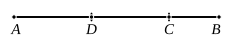

E.g. in case (1) they are $\sqrt{a\sqrt{B}}$, $\sqrt{\frac{aC}{\sqrt{B}}}$,
in case (2) they are $\sqrt[4]{AB}$, $\sqrt{\frac{C\sqrt{A}}{\sqrt{B}}}$,
and so on.

---

### LEMMA I.

*To find two square numbers such that their sum is also
square.*

Let two numbers *AB*, *BC* be set out, and let them be
either both even or both odd.

Then since, whether an even number is subtracted from an
even number, or an odd number from an odd number, the
remainder is even, [IX. 24, 26]
therefore the remainder *AC* is even.

Let *AC* be bisected at *D*.

Let *AB*, *BC* also be either similar plane numbers, or
square numbers, which are themselves also similar plane
numbers.

Now the product of *AB*, *BC* together with the square on
*CD* is equal to the square on *BD*. [II. 6]

And the product of *AB*, *BC* is square, inasmuch as it
was proved that, if two similar plane numbers by multiplying
one another make some number the product is square. [IX. 1]

Therefore two square numbers, the product of *AB*, *BC*,
and the square on *CD*, have been found which, when added
together, make the square on *BD*.

And it is manifest that two square numbers, the square
on *BD* and the square on *CD*, have again been found such
that their difference, the product of *AB*, *BC*, is a square,
whenever *AB*, *BC* are similar plane numbers.

But when they are not similar plane numbers, two square
numbers, the square on *BD* and the square on *DC*, have been
found such that their difference, the product of *AB*, *BC*, is
not square.

Q. E. D.

---

Euclid's method of forming right-angled triangles in integral numbers,
already alluded to in the note on I. 47, is as follows.

Take two similar plane numbers, e.g. $mnp^2$, $mnq^2$, *which are either both even*
*or both odd*, so that their difference is divisible by 2.
