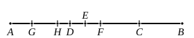

Now the product of the two numbers, or $m^2n^2p^2q^2$, is square, [IX. 1] 
and, by II. 6,
$$mnp^2 \cdot mnq^2 + \left(\frac{mnp^2 - mnq^2}{2}\right)^2 = \left(\frac{mnp^2 + mnq^2}{2}\right)^2,$$
so that the numbers $mnpq$, $\frac{1}{2}(mnp^2 - mnq^2)$ satisfy the condition that the sum 
of their squares is also a square number.

It is also clear that $\frac{1}{2}(mnp^2 + mnq^2)$, $mnpq$ are numbers such that the 
*difference* of their squares is also square.

---

### Lemma 2.

To find two square numbers such that their sum is not 
square.

For let the product of $AB$, $BC$, as we said, be square, 
and $CA$ even, 
and let $CA$ be bisected by $D$.

It is then manifest that the square product of $AB$, $BC$ 
together with the square on $CD$ is equal to the square on $BD$. [See Lemma 1]

Let the unit $DE$ be subtracted;

therefore the product of $AB$, $BC$ together with the square on 
$CE$ is less than the square on $BD$.

I say then that the square product of $AB$, $BC$ together 
with the square on $CE$ will not be square.

For, if it is square, it is either equal to the square on $BE$, 
or less than the square on $BE$, but cannot any more be 
greater, lest the unit be divided.

First, if possible, let the product of $AB$, $BC$ together 
with the square on $CE$ be equal to the square on $BE$, 
and let $GA$ be double of the unit $DE$.

Since then the whole $AC$ is double of the whole $CD$, 
and in them $AG$ is double of $DE$,

therefore the remainder $GC$ is also double of the remainder $EC$; 
therefore $GC$ is bisected by $E$.

Therefore the product of $GB$, $BC$ together with the square 
on $CE$ is equal to the square on $BE$. [II. 6]

But the product of $AB$, $BC$ together with the square on 
$CE$ is also, by hypothesis, equal to the square on $BE$;

