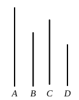

therefore neither has the square on $AB$ to the square on $BF$ the ratio which a square number has to a square number; therefore $AB$ is incommensurable in length with $BF$. [x. 9]

And the square on $AB$ is greater than the square on $AF$ by the square on $FB$ incommensurable with $AB$.

Therefore $AB$, $AF$ are rational straight lines commensurable in square only, and the square on $AB$ is greater than the square on $AF$ by the square on $FB$ incommensurable in length with $AB$.

Q. E. D.

---

In this case we take $m^2$, $n^2$ such that $m^2 + n^2$ is not square.

Find $x$ such that
$$m^2 + n^2 : m^2 = \rho^2 : x^2,$$
whence
$$x^2 = \frac{m^2}{m^2 + n^2} \rho^2,$$
or
$$x = \frac{\rho}{\sqrt{1 + k^2}}, \quad \text{where } k = \frac{n}{m}.$$

Then $\rho$, $\frac{\rho}{\sqrt{1 + k^2}}$ satisfy the condition.

The proof is after the manner of the proof of the preceding proposition and need not be repeated.

According as $\rho$ is of the form $a$ or $\sqrt{A}$, the straight lines take the form (1) $a$, $\sqrt{a^2 - \frac{k^2 a^2}{1 + k^2}}$, that is, $a$, $\sqrt{a^2 - B}$, or (2) $\sqrt{A}$, $\sqrt{A - B}$ and $\sqrt{A}$, $\sqrt{A - b^2}$.

---

### PROPOSITION 31.

*To find two medial straight lines commensurable in square only, containing a rational rectangle, and such that the square on the greater is greater than the square on the less by the square on a straight line commensurable in length with the greater.*

Let there be set out two rational straight lines $A$, $B$ commensurable in square only and such that the square on $A$, being the greater, is greater than the square on $B$ the less by the square on a straight line commensurable in length with $A$. [x. 29]

And let the square on $C$ be equal to the rectangle $A$, $B$.

Now the rectangle $A$, $B$ is medial; [x. 21] therefore the square on $C$ is also medial; therefore $C$ is also medial. [x. 21]
