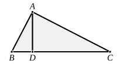

II. If the other conditions are the same, but the square on the first medial straight line is to exceed the square on the second by the square on a straight line *incommensurable* with the first, we begin with the three straight lines $\rho$, $\rho\sqrt{\lambda}$, $\dfrac{\rho}{\sqrt{1+k^2}}$, and the medial straight lines are
$$\rho\lambda^{\frac{1}{4}},\quad \dfrac{\rho\lambda^{\frac{1}{4}}}{\sqrt{1+k^2}}.$$

The possible forms are even more various in this case owing to the more various forms that the original lines may take, e.g.
$$\begin{array}{llll}
(1) & a, & \sqrt{B}, & \sqrt{a^2-C} ; \\
(2) & \sqrt{A}, & b, & \sqrt{A-c^2} ; \\
(3) & \sqrt{A}, & b, & \sqrt{A-C} ; \\
(4) & \sqrt{A}, & \sqrt{B}, & \sqrt{A-c^2} ; \\
(5) & \sqrt{A}, & \sqrt{B}, & \sqrt{A-C} ;
\end{array}$$
the medial straight lines corresponding to these being
$$\begin{array}{lcc}
(1) & \sqrt{a\sqrt{B}}, & \dfrac{\sqrt{B(a^2-C)}}{\sqrt{a\sqrt{B}}} ; \\
(2) & \sqrt{b\sqrt{A}}, & \dfrac{b\sqrt{A-c^2}}{\sqrt{b\sqrt{A}}} ; \\
(3) & \sqrt{b\sqrt{A}}, & \dfrac{b\sqrt{A-C}}{\sqrt{b\sqrt{A}}} ; \\
(4) & \sqrt[4]{AB}, & \dfrac{\sqrt{B(A-c^2)}}{\sqrt[4]{AB}} ; \\
(5) & \sqrt[4]{AB}, & \dfrac{\sqrt{B(A-C)}}{\sqrt[4]{AB}}.
\end{array}$$

---

### LEMMA.

Let $ABC$ be a right-angled triangle having the angle $A$ right, and let the perpendicular $AD$ be drawn ;
I say that the rectangle $CB, BD$ is equal to the square on $BA$,
the rectangle $BC, CD$ equal to the square on $CA$,
the rectangle $BD, DC$ equal to the square on $AD$,
and, further, the rectangle $BC, AD$ equal to the rectangle $BA, AC$.

