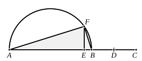

And first that the rectangle $CB$, $BD$ is equal to the square 
on $BA$.

For, since in a right-angled triangle $AD$ has been drawn 
from the right angle perpendicular to the base,

therefore the triangles ">$ABD$, ">$ADC$ are similar both to the 
whole ">$ABC$ and to one another. [VI. 8]

And since the triangle ">$ABC$ is similar to the triangle ">$ABD$,

therefore, as $CB$ is to $BA$, so is $BA$ to $BD$ ; [VI. 4] 
therefore the rectangle $CB$, $BD$ is equal to the square on $AB$. 
[VI. 17]

For the same reason the rectangle $BC$, $CD$ is also equal 
to the square on $AC$.

And since, if in a right-angled triangle a perpendicular 
be drawn from the right angle to the base, the perpendicular 
so drawn is a mean proportional between the segments of the 
base, [VI. 8, Por.]

therefore, as $BD$ is to $DA$, so is $AD$ to $DC$ ; 
therefore the rectangle $BD$, $DC$ is equal to the square on $AD$. 
[VI. 17]

I say that the rectangle $BC$, $AD$ is also equal to the rect- 
angle $BA$, $AC$.

For since, as we said, ">$ABC$ is similar to ">$ABD$,

therefore, as $BC$ is to $CA$, so is $BA$ to $AD$. [VI. 4]

Therefore the rectangle $BC$, $AD$ is equal to the rectangle 
$BA$, $AC$. [VI. 16]

Q. E. D.

---

### PROPOSITION 33.

To find two straight lines incommensurable in square which 
make the sum of the squares on them rational but the rectangle 
contained by them medial.

Let there be set out two rational straight lines $AB$, $BC$ 
commensurable in square only 
and such that the square on the 
greater $AB$ is greater than the 
square on the less $BC$ by the 
square on a straight line in- 
commensurable with $AB$, 
[X. 30]

