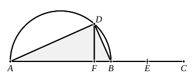

But $\dfrac{\rho^2}{\sqrt{1+k^2}}$ is a medial area,
therefore $uv$ is medial.

Since $\rho$, $\dfrac{\rho}{\sqrt{1+k^2}}$ may have any of the three forms
(1) $a$, $\sqrt{a^2-B}$, (2) $\sqrt{A}$, $\sqrt{A-B}$, (3) $\sqrt{A}$, $\sqrt{A-b^2}$,
$u, v$ may have any of the forms
$$\begin{array}{lcc}
(1) & \sqrt{\dfrac{a^2 + a\sqrt{B}}{2}}, & \sqrt{\dfrac{a^2 - a\sqrt{B}}{2}} ; \\
(2) & \sqrt{\dfrac{A + \sqrt{AB}}{2}}, & \sqrt{\dfrac{A - \sqrt{AB}}{2}} ; \\
(3) & \sqrt{\dfrac{A + b\sqrt{A}}{2}}, & \sqrt{\dfrac{A - b\sqrt{A}}{2}}.
\end{array}$$

---

### PROPOSITION 34.

*To find two straight lines incommensurable in square which make the sum of the squares on them medial but the rectangle contained by them rational.*

Let there be set out two medial straight lines $AB, BC$, commensurable in square only, such that the rectangle which they contain is rational, and the square on $AB$ is greater than the square on $BC$ by the square on a straight line incommensurable with $AB$ ; [x. 31, ad fin.]

let the semicircle $ADB$ be described on $AB$,
let $BC$ be bisected at $E$,
let there be applied to $AB$ a parallelogram equal to the square on $BE$ and deficient by a square figure, namely the rectangle $AF, FB$ ; [vi. 28]
therefore $AF$ is incommensurable in length with $FB$. [x. 18]

Let $FD$ be drawn from $F$ at right angles to $AB$,
and let $AD, DB$ be joined.
