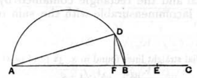

let the semicircle *ADB* be described on *AB*, and let the rest of the construction be as above.

Then, since *AF* is incommensurable in length with *FB*, [x. 18] *AD* is also incommensurable in square with *DB*. [x. 11]

And, since the square on *AB* is medial, therefore the sum of the squares on *AD*, *DB* is also medial. [III. 31, I. 47]

And, since the rectangle *AF*, *FB* is equal to the square on each of the straight lines *BE*, *DF*, therefore *BE* is equal to *DF*; therefore *BC* is double of *FD*, so that the rectangle *AB*, *BC* is also double of the rectangle *AB*, *FD*.

But the rectangle *AB*, *BC* is medial; therefore the rectangle *AB*, *FD* is also medial. [x. 32, Por.]

And it is equal to the rectangle *AD*, *DB*; [Lemma after x. 32] therefore the rectangle *AD*, *DB* is also medial.

And, since *AB* is incommensurable in length with *BC*, while *CB* is commensurable with *BE*, therefore *AB* is also incommensurable in length with *BE*, [x. 13] so that the square on *AB* is also incommensurable with the rectangle *AB*, *BE*. [x. 11]

But the squares on *AD*, *DB* are equal to the square on *AB*, [I. 47] and the rectangle *AB*, *FD*, that is, the rectangle *AD*, *DB*, is equal to the rectangle *AB*, *BE*; therefore the sum of the squares on *AD*, *DB* is incommensurable with the rectangle *AD*, *DB*.
