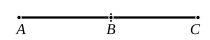

According as $\rho$ is of the form $a$ or $\sqrt{A}$, we have a variety of forms for $u$, $v$, arrived at by using the same transformations as in the notes on x. 30 and x. 32 (second part), e.g.
$$(1) \quad \sqrt{\frac{(a + \sqrt{C})\sqrt{B}}{2}}, \quad \sqrt{\frac{(a - \sqrt{C})\sqrt{B}}{2}};$$
$$(2) \quad \sqrt{\frac{(\sqrt{A} + \sqrt{C})\sqrt{B}}{2}}, \quad \sqrt{\frac{(\sqrt{A} - \sqrt{C})\sqrt{B}}{2}};$$
$$(3) \quad \sqrt{\frac{(\sqrt{A} + c)\sqrt{B}}{2}}, \quad \sqrt{\frac{(\sqrt{A} - c)\sqrt{B}}{2}};$$
and the expressions in (2), (3) with $b$ in place of $\sqrt{B}$.

---

### PROPOSITION 36.

*If two rational straight lines commensurable in square only be added together, the whole is irrational; and let it be called* **binomial**.

For let two rational straight lines $AB$, $BC$ commen-
5 surable in square only be added together;

I say that the whole $AC$ is irrational.

For, since $AB$ is incommensurable in length with $BC$—
10 for they are commensurable in square only—
and, as $AB$ is to $BC$, so is the rectangle $AB$, $BC$ to the square on $BC$,
therefore the rectangle $AB$, $BC$ is incommensurable with the square on $BC$. [x. 11]

15 But twice the rectangle $AB$, $BC$ is commensurable with the rectangle $AB$, $BC$ [x. 6], and the squares on $AB$, $BC$ are commensurable with the square on $BC$—for $AB$, $BC$ are rational straight lines commensurable in square only— [x. 15]
therefore twice the rectangle $AB$, $BC$ is incommensurable
20 with the squares on $AB$, $BC$. [x. 13]

And, *componendo*, twice the rectangle $AB$, $BC$ together with the squares on $AB$, $BC$, that is, the square on $AC$ [II. 4], is incommensurable with the sum of the squares on $AB$, $BC$. [x. 16]

But the sum of the squares on $AB$, $BC$ is rational;
25 therefore the square on $AC$ is irrational,
so that $AC$ is also irrational. [x. Def. 4]

And let it be called **binomial**.
