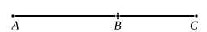

Here begins the first hexad of propositions relating to compound irrational 
straight lines. The six compound irrational straight lines are formed by 
*adding* two parts, as the corresponding six in Props. 73—78 are formed by 
*subtraction*. The relation between the six irrational straight lines in this and 
the next five propositions with those described in Definitions II. and the 
Props. 48—53 following thereon (the *first, second, third, fourth, fifth* and 
*sixth binomials*) will be seen when we come to Props. 54—59; but it may be 
stated here that the six compound irrationals in Props. 36—41 can be found 
by means of the equivalent of extracting the square root of the compound 
irrationals in x. 48—53 (the process being, strictly speaking, the finding of the 
sides of the squares equal to the rectangles contained by the latter irrationals 
respectively and a rational straight line as the other side), and it is therefore 
the further removed compound irrational, so to speak, which is treated first.

In reproducing the proofs of the propositions, I shall for the sake of 
simplicity call the two parts of the compound irrational straight line $x$, $y$, 
explaining at the outset the forms which $x$, $y$ really have in each case; $x$ will 
always be supposed to be the greater segment.

In this proposition $x$, $y$ are of the form $\rho$, $\sqrt{k} \cdot \rho$, and $(x + y)$ is proved to 
be irrational thus.

$x \sim y$, so that $x \mathbin{\smile} y$.

Now
$$x : y = x^2 : xy,$$
so that
$$x^2 \mathbin{\smile} xy.$$

But $x^2 \mathbin{\sim} (x^2 + y^2)$, and $xy \mathbin{\sim} 2xy$; 
therefore
$$(x^2 + y^2) \mathbin{\smile} 2xy,$$
and hence
$$(x^2 + y^2 + 2xy) \mathbin{\smile} (x^2 + y^2).$$

But $(x^2 + y^2)$ is rational; 
therefore $(x + y)^2$, and therefore $(x + y)$, is irrational.

This irrational straight line, $\rho + \sqrt{k} \cdot \rho$, is called a **binomial** straight line.

This and the corresponding apotome ($\rho - \sqrt{k} \cdot \rho$) found in x. 73 are the 
positive roots of the equation
$$x^4 - 2(1 + k)\rho^2 \cdot x^2 + (1 - k)^2\rho^4 = 0.$$

---

### PROPOSITION 37.

If two medial straight lines commensurable in square only 
and containing a rational rectangle be added together, the 
whole is irrational; and let it be called a <strong>first bimedial 
straight line</strong>.

For let two medial straight lines $AB$, $BC$ commensurable 
in square only and containing 
a rational rectangle be added 
together; 
I say that the whole $AC$ is irrational.

For, since $AB$ is incommensurable in length with $BC$,

therefore the squares on $AB$, $BC$ are also incommensurable 
with twice the rectangle $AB$, $BC$; [cf. x. 36, ll. 9—20]

