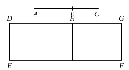

and, *componendo*, the squares on $AB$, $BC$ together with twice the rectangle $AB$, $BC$, that is, the square on $AC$ [II. 4], is incommensurable with the rectangle $AB$, $BC$. [x. 16]

But the rectangle $AB$, $BC$ is rational, for, by hypothesis, $AB$, $BC$ are straight lines containing a rational rectangle;
therefore the square on $AC$ is irrational;
therefore $AC$ is irrational. [x. Def. 4]

And let it be called a **first bimedial** straight line.

Q. E. D.

---

Here $x$, $y$ have the forms $k^{\frac{1}{4}}\rho$, $k^{\frac{3}{4}}\rho$ respectively, as found in x. 27.
Exactly as in the last case we prove that
$$x^2 + y^2 \mathbin{\smile} 2xy,$$
whence
$$(x + y)^2 \mathbin{\smile} 2xy.$$

But $xy$ is rational;
therefore $(x + y)^2$, and consequently $(x + y)$, is irrational.

The irrational straight line $k^{\frac{1}{4}}\rho + k^{\frac{3}{4}}\rho$ is called a *first bimedial* straight line.

This and the corresponding *first apotome of a medial* ($k^{\frac{1}{4}}\rho - k^{\frac{3}{4}}\rho$) found in x. 74 are the positive roots of the equation
$$x^4 - 2\sqrt{k}(1 + k)\rho^2 \cdot x^2 + k(1 - k)^2\rho^4 = 0.$$

---

### PROPOSITION 38.

*If two medial straight lines commensurable in square only and containing a medial rectangle be added together, the whole is irrational; and let it be called a* **second bimedial** *straight line.*

5 For let two medial straight lines $AB$, $BC$ commensurable in square only and containing a medial rectangle be added together;

I say that $AC$ is irrational.

10 For let a rational straight line $DE$ be set out, and let the parallelogram ">$DF$ equal to the square on $AC$ be applied to $DE$, producing $DG$ as breadth. [I. 44]

15 Then, since the square on $AC$ is equal to the squares on $AB$, $BC$ and twice the rectangle $AB$, $BC$, [II. 4]
let ">$EH$, equal to the squares on $AB$, $BC$, be applied to $DE$;
