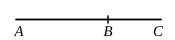

For let two straight lines $AB$, $BC$ incommensurable in 
square, and fulfilling the given con- 
ditions [X. 34], be added together; 
I say that $AC$ is irrational.

For, since the sum of the squares on $AB$, $BC$ is medial, 
while twice the rectangle $AB$, $BC$ is rational,

therefore the sum of the squares on $AB$, $BC$ is incommen- 
surable with twice the rectangle $AB$, $BC$; 
so that the square on $AC$ is also incommensurable with twice 
the rectangle $AB$, $BC$. [X. 16]

But twice the rectangle $AB$, $BC$ is rational;

therefore the square on $AC$ is irrational.

5 Therefore $AC$ is irrational. [X. Def. 4]

And let it be called the **side of a rational plus a 
medial area**.

Q. E. D.

---

Here $x$, $y$ have [X. 34] the forms
$$\frac{\rho}{\sqrt{2(1+k^2)}}\sqrt{\sqrt{1+k^2}+k},\quad \frac{\rho}{\sqrt{2(1+k^2)}}\sqrt{\sqrt{1+k^2}-k}.$$

In this case $(x^2+y^2)$ is a medial, and $2xy$ a rational, area; thus
$$x^2+y^2 \cup 2xy.$$

Therefore
$$(x+y)^2 \cup 2xy,$$
whence, since $2xy$ is rational, 
$(x+y)^2$, and consequently $(x+y)$, is irrational.

The irrational straight line
$$\frac{\rho}{\sqrt{2(1+k^2)}}\sqrt{\sqrt{1+k^2}+k} + \frac{\rho}{\sqrt{2(1+k^2)}}\sqrt{\sqrt{1+k^2}-k}$$
is called (for an obvious reason) the “*side*” of a rational plus a medial (area).

This and the corresponding irrational with a minus sign found in x. 77 
are the positive roots of the equation
$$x^4 - \frac{2}{\sqrt{1+k^2}}\rho^2 \cdot x^2 + \frac{k^2}{(1+k^2)^2}\rho^4 = 0.$$

---

### PROPOSITION 41.

If two straight lines incommensurable in square which 
make the sum of the squares on them medial, and the rectangle 
contained by them medial and also incommensurable with the 
sum of the squares on them, be added together, the whole straight 
line is irrational; and let it be called the **side of the sum 
of two medial areas.**

