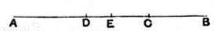

By hypothesis, $(x^2+y^2)$ and $2xy$ are medial areas, and
$$x^2+y^2 \cup 2xy \dots\dots\dots\dots\dots\dots\dots\dots(1).$$

‘Apply’ these areas respectively to a rational straight line $\sigma$, and suppose
$$\left.\begin{aligned} x^2+y^2 &= \sigma u \\ 2xy &= \sigma v \end{aligned}\right\} \dots\dots\dots\dots\dots\dots\dots\dots(2).$$

Since then $\sigma u$ and $\sigma v$ are both medial areas, $u$, $v$ are rational and both are $\cup\ \sigma$ $\dots\dots\dots\dots\dots\dots\dots\dots(3)$.

Now, by (1) and (2),
$$\sigma u \cup \sigma v,$$
so that
$$u \cup v.$$

By this and (3), $u$, $v$ are rational and $\sim$.

Therefore [x. 36] $(u+v)$ is irrational.

Hence $\sigma(u+v)$ is irrational [deduction from x. 20].

Thus $(x+y)^2$, and therefore $(x+y)$, is irrational.

The irrational straight line
$$\frac{\rho\lambda^{\frac{1}{4}}}{\sqrt{2}}\sqrt{1+\frac{k}{\sqrt{1+k^2}}} + \frac{\rho\lambda^{\frac{1}{4}}}{\sqrt{2}}\sqrt{1-\frac{k}{\sqrt{1+k^2}}}$$
is called (again for an obvious reason) the “*side*” *of the sum of two medials* (medial areas).

This and the corresponding irrational with a minus sign found in x. 78 are the positive roots of the equation
$$x^4 - 2\sqrt{\lambda}\cdot x^2\rho^2 + \lambda\frac{k^2}{1+k^2}\rho^4 = 0.$$

---

### LEMMA.

And that the aforesaid irrational straight lines are divided only in one way into the straight lines of which they are the sum and which produce the types in question,[^92_3] we will now prove after premising the following lemma.

Let the straight line $AB$ be set out, let the whole be cut into unequal parts at each of the points $C$, $D$, and let $AC$ be supposed greater than $DB$;
I say that the squares on $AC$, $CB$ are greater than the squares on $AD$, $DB$.

For let $AB$ be bisected at $E$.

Then, since $AC$ is greater than $DB$,
let $DC$ be subtracted from each;
therefore the remainder $AD$ is greater than the remainder $CB$.

But $AE$ is equal to $EB$;
therefore $DE$ is less than $EC$;
