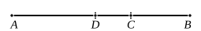

therefore the points $C$, $D$ are not equidistant from the point of bisection.

And, since the rectangle $AC$, $CB$ together with the square on $EC$ is equal to the square on $EB$, [II. 5]
and, further, the rectangle $AD$, $DB$ together with the square on $DE$ is equal to the square on $EB$, [id.]
therefore the rectangle $AC$, $CB$ together with the square on $EC$ is equal to the rectangle $AD$, $DB$ together with the square on $DE$.

And of these the square on $DE$ is less than the square on $EC$;
therefore the remainder, the rectangle $AC$, $CB$, is also less than the rectangle $AD$, $DB$,
so that twice the rectangle $AC$, $CB$ is also less than twice the rectangle $AD$, $DB$.

Therefore also the remainder, the sum of the squares on $AC$, $CB$, is greater than the sum of the squares on $AD$, $DB$.

Q. E. D.

---

[^92_3]: **and which produce the types in question.** The Greek is ποιουσῶν τὰ προκείμενα εἴδη, and I have taken εἴδη to mean “types (of irrational straight lines),” though the expression might perhaps mean “satisfying the conditions in question.”

This proves that, if $x + y = u + v$, and if $u$, $v$ are more nearly equal than $x$, $y$ (i.e. if the straight line is divided in the second case nearer to the point of bisection), then
$$(x^2 + y^2) > (u^2 + v^2).$$

It is first proved by means of II. 5 that
$$2xy < 2uv,$$
whence, since $(x+y)^2 = (u+v)^2$, the required result follows.

---

### PROPOSITION 42.

*A binomial straight line is divided into its terms at one point only.*

Let $AB$ be a binomial straight line divided into its terms at $C$;
therefore $AC$, $CB$ are rational straight lines commensurable in square only. [x. 36]

I say that $AB$ is not divided at another point into two rational straight lines commensurable in square only.
