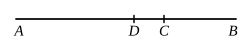

The proposition states that a binomial straight line cannot be split up into 
*terms* (ὀνόματα) in two ways. For, if possible, let
$$x + y = x' + y',$$
where $x$, $y$, and also $x'$, $y'$, are the *terms* of a binomial straight line, $x'$, $y'$ 
being different from $x$, $y$ (or $y$, $x$).

One pair is necessarily more nearly equal than the other. Let $x'$, $y'$ be 
more nearly equal than $x$, $y$.

Then
$$(x^2 + y^2) - (x'^2 + y'^2) = 2x'y' - 2xy.$$

Now by hypothesis $(x^2 + y^2)$, $(x'^2 + y'^2)$ are rational areas, being of the form 
$\rho^2 + k\rho^2$; 
but $2x'y'$, $2xy$ are medial areas, being of the form $\sqrt{k}\cdot\rho^2$; 
therefore the difference of two medial areas is rational: 
which is impossible. [x. 26]

Therefore $x'$, $y'$ cannot be different from $x$, $y$ (or $y$, $x$).

---

### PROPOSITION 43.

A first bimedial straight line is divided at one point only.

Let $AB$ be a first bimedial straight line divided at $C$, so 
that $AC$, $CB$ are medial straight 
lines commensurable in square 
only and containing a rational 
rectangle; [X. 37]

I say that $AB$ is not so divided at another point.

For, if possible, let it be divided at $D$ also, so that $AD$, 
$DB$ are also medial straight lines commensurable in square 
only and containing a rational rectangle.

Since, then, that by which twice the rectangle $AD$, $DB$ 
differs from twice the rectangle $AC$, $CB$ is that by which the 
squares on $AC$, $CB$ differ from the squares on $AD$, $DB$, 
while twice the rectangle $AD$, $DB$ differs from twice the 
rectangle $AC$, $CB$ by a rational area—for both are rational—

therefore the squares on $AC$, $CB$ also differ from the squares 
on $AD$, $DB$ by a rational area, though they are medial : 
which is absurd. [X. 26]

Therefore a first bimedial straight line is not divided into 
its terms at different points; 
therefore it is so divided at one point only.

