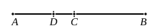

### PROPOSITION 46.

The side of a rational plus a medial area is divided at one 
point only.

Let $AB$ be the side of a rational plus a medial area 
divided at $C$, so that $AC$, $CB$ are 
incommensurable in square and make 
the sum of the squares on $AC$, $CB$ 
medial, but twice the rectangle $AC$, $CB$ rational; [X. 40] 
I say that $AB$ is not so divided at another point.

For, if possible, let it be divided at $D$ also, so that $AD$, 
$DB$ are also incommensurable in square and make the sum 
of the squares on $AD$, $DB$ medial, but twice the rectangle 
$AD$, $DB$ rational.

Since then that by which twice the rectangle $AC$, $CB$ 
differs from twice the rectangle $AD$, $DB$ is also that by 
which the squares on $AD$, $DB$ differ from the squares on 
$AC$, $CB$,

while twice the rectangle $AC$, $CB$ exceeds twice the rectangle 
$AD$, $DB$ by a rational area,

therefore the squares on $AD$, $DB$ also exceed the squares 
on $AC$, $CB$ by a rational area, though they are medial:

which is impossible. [X. 26]

Therefore the side of a rational plus a medial area is not 
divided at different points; 
therefore it is divided at one point only.Q. E. D.

---

Here, as before, if we use the same notation,
$$(x^2 + y^2) - (x'^2 + y'^2) = 2x'y' - 2xy,$$
and the areas on the left side are, by hypothesis, both medial, while the areas 
on the right side are both rational.

Thus the result of X. 26 is contradicted, as before.

Therefore etc.

---

### PROPOSITION 47.

The side of the sum of two medial areas is divided at one 
point only.

Let $AB$ be divided at $C$, so that $AC$, $CB$ are incommen- 
surable in square and make the sum of the squares on $AC$,
