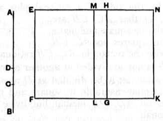

$CB$ medial, and the rectangle $AC, CB$ medial and also incommensurable with the sum of the squares on them;
I say that $AB$ is not divided at another point so as to fulfil the given conditions.

For, if possible, let it be divided at $D$, so that again $AC$ is of course not the same as $BD$, but $AC$ is supposed greater;
let a rational straight line $EF$ be set out,
and let there be applied to $EF$ the rectangle $EG$ equal to the squares on $AC, CB$,
and the rectangle $HK$ equal to twice the rectangle $AC, CB$;
therefore the whole $EK$ is equal to the square on $AB$. [II. 4]

Again, let $EL$, equal to the squares on $AD, DB$, be applied to $EF$;
therefore the remainder, twice the rectangle $AD, DB$, is equal to the remainder $MK$.

And since, by hypothesis, the sum of the squares on $AC, CB$ is medial,
therefore $EG$ is also medial.

And it is applied to the rational straight line $EF$;
therefore $HE$ is rational and incommensurable in length with $EF$. [x. 22]

For the same reason
$HN$ is also rational and incommensurable in length with $EF$.

And, since the sum of the squares on $AC, CB$ is incommensurable with twice the rectangle $AC, CB$,
therefore $EG$ is also incommensurable with $GN$,
so that $EH$ is also incommensurable with $HN$. [VI. 1, x. 11]

And they are rational;
