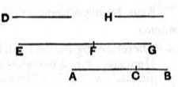

3. and if neither of the terms be commensurable in length with the rational straight line set out, let the whole be called a **third binomial**.

4. Again, if the square on the greater term be greater than the square on the lesser by the square on a straight line incommensurable in length with the greater, then, if the greater term be commensurable in length with the rational straight line set out, let the whole be called a **fourth binomial**;

5. if the lesser, a **fifth binomial**;

6. and if neither, a **sixth binomial**.

---

### PROPOSITION 48.

#### *To find the first binomial straight line.*

Let two numbers $AC$, $CB$ be set out such that the sum of them $AB$ has to $BC$ the ratio which a square number has to a square number, but has not to $CA$ the ratio which a square number has to a square number; [Lemma 1 after x. 28]
let any rational straight line $D$ be set out, and let $EF$ be commensurable in length with $D$.
    Therefore $EF$ is also rational.
    Let it be contrived that, as the number $BA$ is to $AC$, so is the square on $EF$ to the square on $FG$. [x. 6, Por.]
    But $AB$ has to $AC$ the ratio which a number has to a number;
therefore the square on $EF$ also has to the square on $FG$ the ratio which a number has to a number, so that the square on $EF$ is commensurable with the square on $FG$. [x. 6]
    And $EF$ is rational;
therefore $FG$ is also rational.
    And, since $BA$ has not to $AC$ the ratio which a square number has to a square number,
