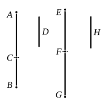

To prove this we have, from (1),
$$x^2 \sim k^2 p^2,$$
and $x$ is rational, but $x \cup kp$;
that is, $x$ is rational and $\sim kp$,
so that $kp + x$ is a binomial straight line.
    Also, $k^2 p^2$ being greater than $x^2$, suppose $k^2 p^2 - x^2 = y^2$.
    Then, from (1),
$$pm^2 : pn^2 = k^2 p^2 : y^2,$$
whence $y$ is rational and $\sim kp$.
    Therefore $kp + x$ is a *first binomial* straight line [x. Deff. II. 1].
    This binomial straight line may be written thus,
$$kp + kp \sqrt{1 - \lambda^2}.$$
    When we come to x. 85, we shall find that the corresponding straight line with a negative sign is the *first apotome*,
$$kp - kp \sqrt{1 - \lambda^2}.$$
    Consider now the equation of which these two expressions are the roots. The equation is
$$x^2 - 2kp \cdot x + \lambda^2 k^2 p^2 = 0.$$
    In other words, the first binomial and the first apotome correspond to the roots of the equation
$$x^2 - 2ax + \lambda^2 a^2 = 0,$$
where $a = kp$.

---

### PROPOSITION 49.

#### *To find the second binomial straight line.*

Let two numbers $AC$, $CB$ be set out such that the sum of them $AB$ has to $BC$ the ratio which a square number has to a square number, but has not to $AC$ the ratio which a square number has to a square number;
let a rational straight line $D$ be set out, and let $EF$ be commensurable in length with $D$;
therefore $EF$ is rational.
    Let it be contrived then that, as the number $CA$ is to $AB$, so also is the square on $EF$ to the square on $FG$; [x. 6, Por.]
therefore the square on $EF$ is commensurable with the square on $FG$. [x. 6]
    Therefore $FG$ is also rational.
    Now, since the number $CA$ has not to $AB$ the ratio which a square number has to a square number, neither has the
