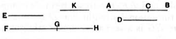

Let
$$x^2 - k^2 p^2 = y^2,$$
whence, from (1),
$$pm^2 : pn^2 = x^2 : y^2,$$
and $y$ is therefore rational and $\sim x$.
    The greater term of the binomial straight line is $x$ and the lesser $kp$, and
$$\frac{kp}{\sqrt{1 - \lambda^2}} + kp$$
satisfies the definition of the second binomial straight line.
    The corresponding *second apotome* [x. 86] is
$$\frac{kp}{\sqrt{1 - \lambda^2}} - kp.$$
    The equation of which the two expressions are the roots is
$$x^2 - \frac{2kp}{\sqrt{1 - \lambda^2}} \cdot x + \frac{\lambda^2}{1 - \lambda^2} k^2 p^2 = 0,$$
or
$$x^2 - 2ax + \lambda^2 a^2 = 0,$$
where
$$a = \frac{kp}{\sqrt{1 - \lambda^2}}.$$

---

### PROPOSITION 50.

#### *To find the third binomial straight line.*

Let two numbers $AC$, $CB$ be set out such that the sum of them $AB$ has to $BC$ the ratio which a square number has to a square number, but has not to $AC$ the ratio which a square number has to a square number.

Let any other number $D$, not square, be set out also, and let it not have to either of the numbers $BA$, $AC$ the ratio which a square number has to a square number.
    Let any rational straight line $E$ be set out,
and let it be contrived that, as $D$ is to $AB$, so is the square on $E$ to the square on $FG$; [x. 6, Por.]
therefore the square on $E$ is commensurable with the square on $FG$. [x. 6]
    And $E$ is rational;
therefore $FG$ is also rational.
